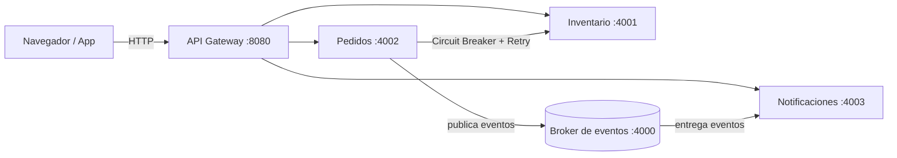
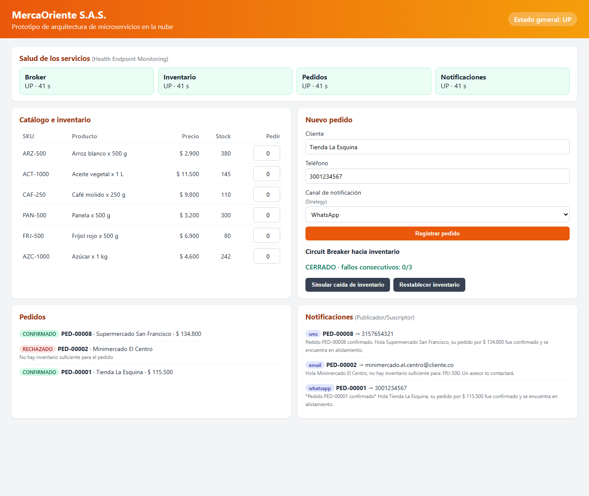
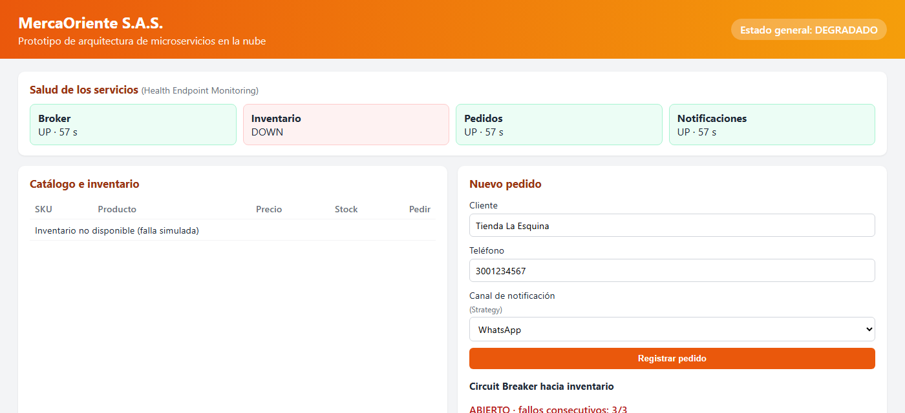

# MercaOriente Cloud · Prototipo de arquitectura de microservicios

Prototipo funcional de la **Actividad 2 – Orquestando códigos: la sinfonía de los sistemas** del curso
**Arquitectura de Software** (Tecnológica del Oriente, Ingeniería de Software).

Simula la plataforma de pedidos de **MercaOriente S.A.S.**, una distribuidora mayorista de víveres de
Bucaramanga que migra su sistema monolítico a una arquitectura modular, escalable y desplegable en la nube.

- **Autor:** Guillermo Andres Garcia Perea
- **Video de presentación:** _(agregar enlace de YouTube no listado)_

## Arquitectura



Cada servicio es un proceso independiente con su propio almacenamiento. Se comunican por HTTP/JSON
y por eventos asíncronos a través del broker.

| Servicio | Responsabilidad |
|---|---|
| `gateway` | Punto de entrada único, enrutamiento, límite de solicitudes, salud agregada y consola web. |
| `pedidos` | Registra pedidos, reserva inventario de forma resiliente y publica eventos. |
| `inventario` | Catálogo y stock; reserva productos de forma atómica. |
| `broker` | Intermediario publicador/suscriptor con reintentos de entrega. |
| `notificaciones` | Se suscribe a los eventos de pedidos y notifica por correo, SMS o WhatsApp. |

Los diagramas UML (casos de uso, clases, secuencia y despliegue) están en [`docs/uml`](docs/uml).

## Patrones aplicados

| Patrón | Tipo | Dónde se aplica |
|---|---|---|
| API Gateway | Nube | [`src/gateway/server.js`](src/gateway/server.js) |
| Publicador/Suscriptor | Nube | [`src/broker/server.js`](src/broker/server.js), [`src/shared/eventBus.js`](src/shared/eventBus.js) |
| Circuit Breaker | Nube (resiliencia) | [`src/shared/circuitBreaker.js`](src/shared/circuitBreaker.js) |
| Retry con espera exponencial | Nube (resiliencia) | [`src/shared/retry.js`](src/shared/retry.js) |
| Health Endpoint Monitoring | Nube (operación) | [`src/shared/servidor.js`](src/shared/servidor.js), `GET /api/salud` |
| Rate Limiting | Nube (protección) | [`src/gateway/limitador.js`](src/gateway/limitador.js) |
| Configuración externa | Nube | [`src/shared/config.js`](src/shared/config.js), [`.env.example`](.env.example) |
| Database per Service + Repository | Datos / diseño | `src/*/…Repositorio.js` |
| Strategy | GoF (comportamiento) | [`src/notificaciones/canales.js`](src/notificaciones/canales.js) |

## Estructura

```text
mercaoriente-cloud/
├── src/
│   ├── index.js              # Arranca el servicio indicado en SERVICE
│   ├── shared/               # Configuración, resiliencia, bus de eventos, servidor base
│   ├── gateway/              # API Gateway + consola web (public/)
│   ├── broker/               # Broker publicador/suscriptor
│   ├── inventario/           # Servicio, repositorio y API de inventario
│   ├── pedidos/              # Servicio, repositorio y API de pedidos
│   └── notificaciones/       # Estrategias de canal y API de notificaciones
├── scripts/
│   ├── iniciar-todo.js       # Levanta los cinco servicios en local
│   └── demo.js               # Ejecuta el escenario de demostración
├── test/                     # Pruebas unitarias (node:test)
├── docs/uml/                 # Fuentes PlantUML e imágenes de los diagramas
├── Dockerfile
├── docker-compose.yml
└── .github/workflows/ci.yml  # Integración continua
```

## Ejecución local

Requisitos: Node.js 18 o superior.

```bash
npm install
npm start          # levanta broker, inventario, pedidos, notificaciones y gateway
```

Abra <http://localhost:8080> para usar la consola web.



Con la caída de inventario simulada, la salud se marca como degradada y el circuito queda abierto:



En otra terminal:

```bash
npm run demo       # pedido confirmado, pedido rechazado, notificaciones y Circuit Breaker
npm test           # pruebas unitarias
```

Salida esperada del Circuit Breaker en la demo:

```text
Intento 1: HTTP 503 · INVENTARIO_NO_DISPONIBLE · ~500 ms · circuito CERRADO
Intento 2: HTTP 503 · INVENTARIO_NO_DISPONIBLE · ~500 ms · circuito CERRADO
Intento 3: HTTP 503 · INVENTARIO_NO_DISPONIBLE · ~500 ms · circuito ABIERTO
Intento 4: HTTP 503 · CIRCUITO_ABIERTO · ~20 ms · circuito ABIERTO
```

## Ejecución con Docker

```bash
docker compose up -d --build
```

La consola queda publicada en el puerto 80 del equipo anfitrión.

## Despliegue en la nube

El prototipo se despliega en cualquier máquina virtual Linux de un proveedor de nube
(AWS EC2, Azure Virtual Machines o Google Compute Engine):

1. Crear una VM Ubuntu 22.04 (por ejemplo `t3.small` en AWS o `B1s` en Azure) y abrir el puerto 80 en el grupo de seguridad.
2. Instalar Docker Engine y el plugin de Compose:
   ```bash
   curl -fsSL https://get.docker.com | sh
   ```
3. Clonar el repositorio y levantar los servicios:
   ```bash
   git clone <url-del-repositorio> && cd mercaoriente-cloud
   sudo docker compose up -d --build
   ```
4. Abrir `http://<ip-publica-de-la-vm>` y verificar `http://<ip-publica-de-la-vm>/api/salud`.

Como todos los servicios usan la misma imagen y se configuran por variables de entorno, también pueden
publicarse como servicios independientes en plataformas administradas (Azure Container Apps, AWS App Runner,
Google Cloud Run, Render o Railway) definiendo `SERVICE`, `PORT` y las URL de los demás servicios.

## API principal (a través del gateway)

| Método | Ruta | Descripción |
|---|---|---|
| GET | `/api/salud` | Estado de todos los servicios |
| GET | `/api/productos` | Catálogo con stock |
| POST | `/api/pedidos` | Registra un pedido |
| GET | `/api/pedidos` | Lista los pedidos |
| GET | `/api/circuito` | Estado del Circuit Breaker hacia inventario |
| GET | `/api/notificaciones` | Notificaciones enviadas |
| GET | `/api/eventos` | Historial de eventos del broker |
| POST | `/api/admin/inventario/falla` | `{ "activa": true }` simula la caída de inventario |

Ejemplo de pedido:

```json
{
  "cliente": { "nombre": "Tienda La Esquina", "telefono": "3001234567", "canal": "whatsapp" },
  "items": [
    { "sku": "ARZ-500", "cantidad": 20 },
    { "sku": "ACT-1000", "cantidad": 5 }
  ]
}
```

## Alcance del prototipo

- El almacenamiento es en memoria por servicio; en producción cada servicio tendría su propia base de datos.
- El broker es propio y sencillo para hacer visible el patrón; en producción se reemplaza por un servicio
  administrado (Amazon SNS/SQS, Azure Service Bus o Google Pub/Sub) sin cambiar a los publicadores.
- El envío de notificaciones es simulado; cada estrategia se conectaría al proveedor real.

## Licencia

MIT
